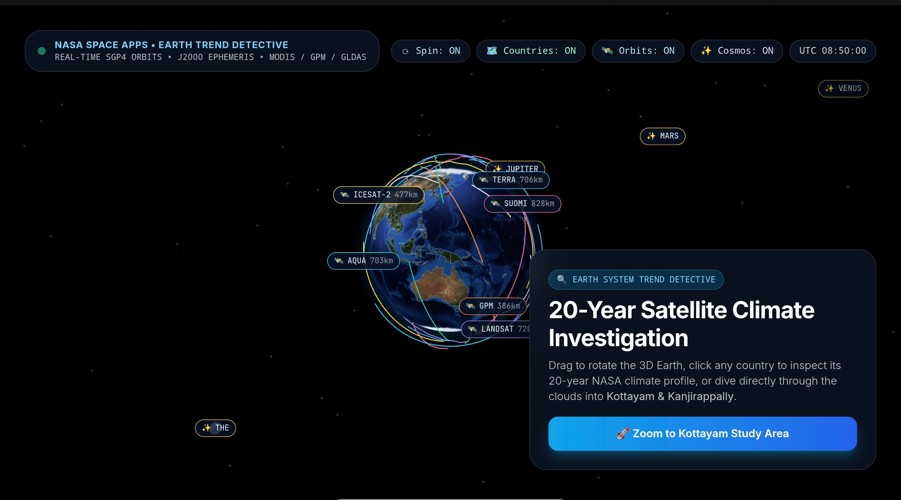
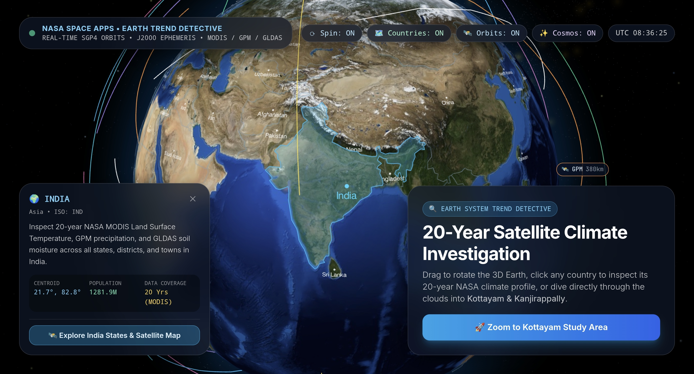
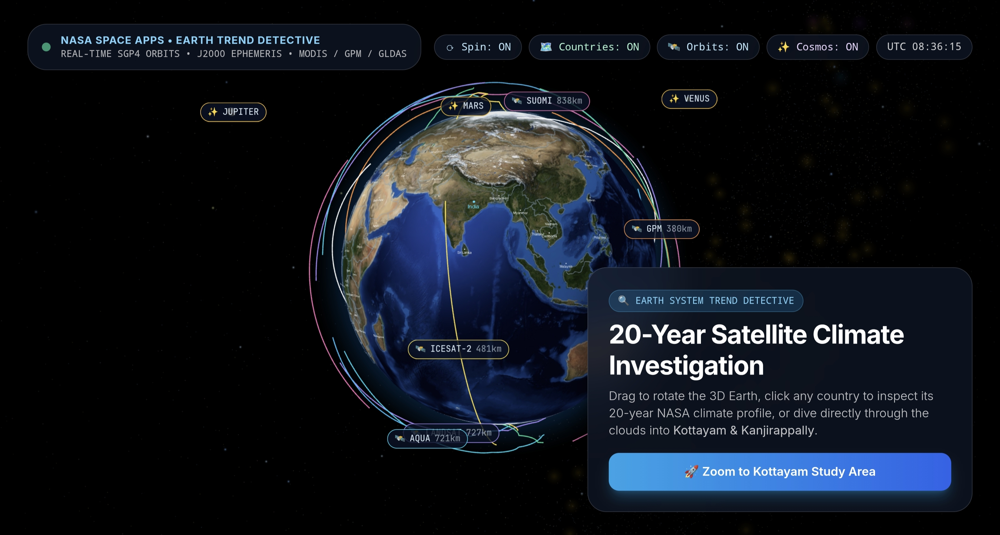
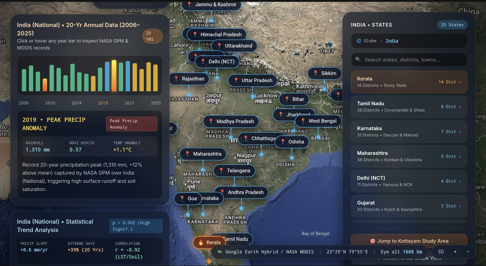
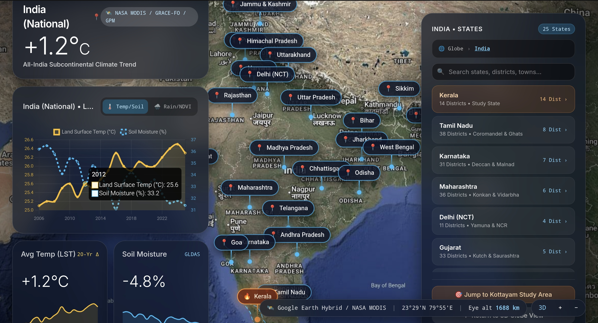
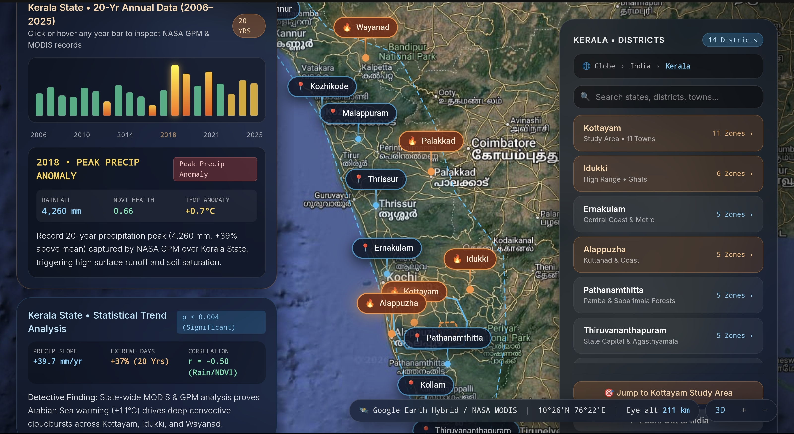
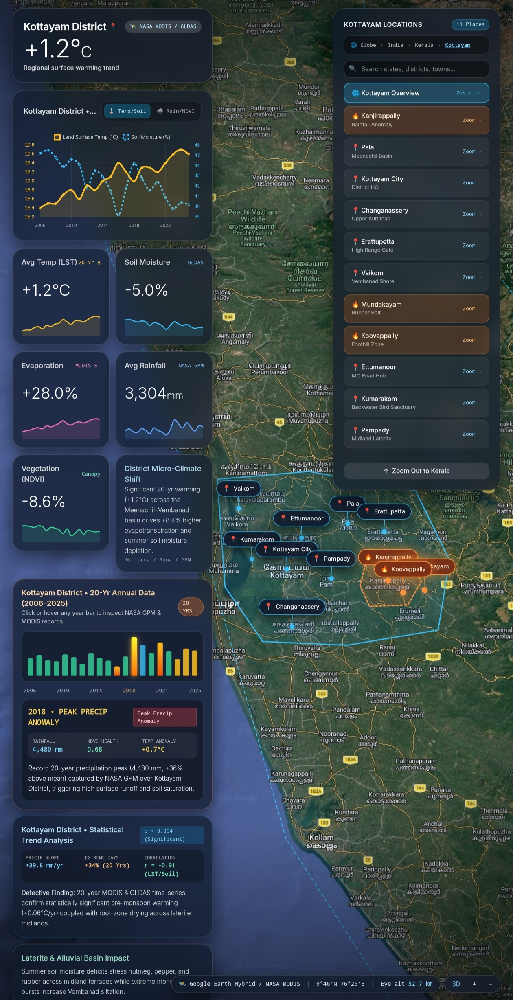
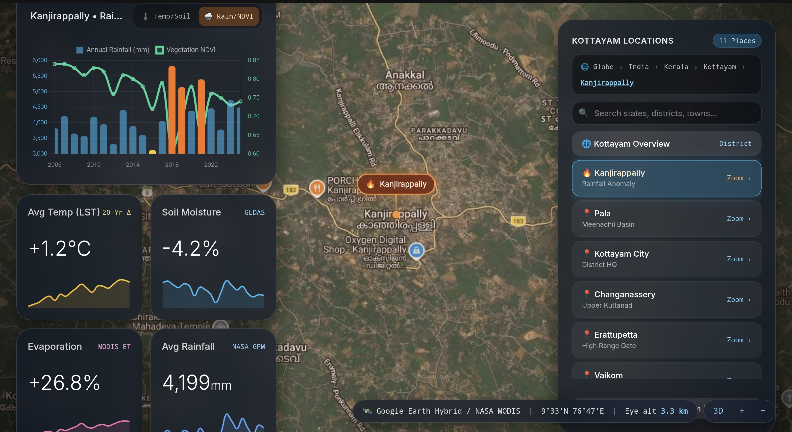
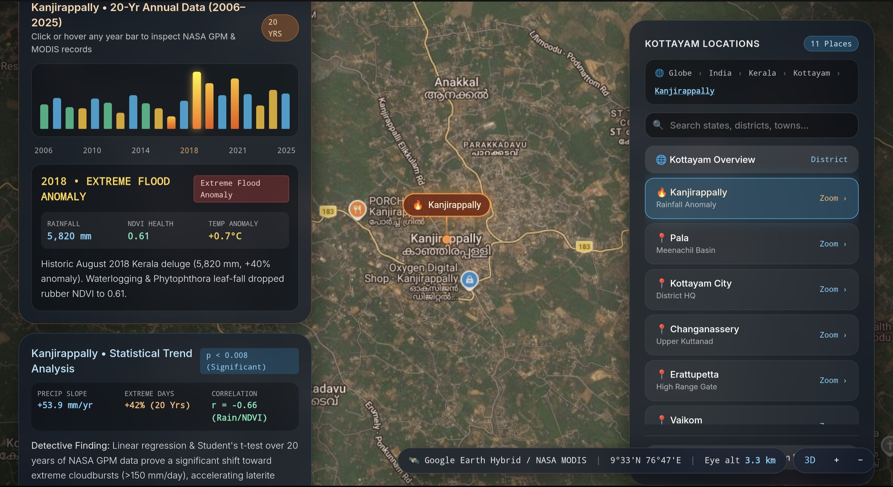

# 🌍 Earth System Trend Detective: 20-Year Climate Investigator

**Built for the NASA Space Apps Challenge 2024: "Be an Earth System Trend Detective!"**

## 🚀 Live Demo
**[Click here to view the Live Web App](https://mingfey.github.io/NASA-Earth-System-Trend-Detective/)**

## 📖 Project Overview
Our project transforms users into Earth System Trend Detectives. We built an interactive, 3D web-based control center that allows users to investigate 20 years (2006–2025) of environmental changes. 

While the app features data for over 90 global countries, our primary case study dives deep into **Kottayam and Kanjirappally, Kerala (India)**. By zooming through the clouds down to high-resolution satellite imagery, we investigate the statistical correlation between rising surface temperatures, changing evapotranspiration, and the increasing frequency of extreme monsoon cloudbursts in the region.

## ✨ Key Features
* **Cinematic 3D Globe & Cloud Dive:** Start in space with a photorealistic 3D Earth, 40,000+ stars, and real-time NASA satellite tracking. Click "Start Investigation" to dive seamlessly through volumetric clouds to the surface.
* **Global to Local Hierarchy:** Explore climate data across 4 levels of detail: Country ➔ State ➔ District ➔ Town. 
* **Interactive 20-Year Timeline:** Click on any year from the last two decades to inspect specific anomalies (like the catastrophic 2018 Kerala floods) and see how rainfall, NDVI, and temperature interacted that year.
* **Statistical Trend Analysis:** On-the-fly calculations showing linear regression slopes (mm/yr) and Pearson correlation coefficients (r) to prove that the climate shift is statistically significant.
* **Dual-View UI:** Switch seamlessly between NASA's orbital view and high-resolution Google Earth hybrid satellite maps.

---

## 📸 Screenshots

### The 3D Orbital Command Center

*Real-time SGP4 tracking of NASA Earth Observation satellites over a 3D globe.*

### National & State Dashboards

*Climate trends and statistical analysis at the national and state levels.*

### Regional Dashboard (Kottayam)

*Data visualizations showing the 20-year warming and soil moisture trends.*

### Sub-Location Deep Dive (Kanjirappally)

*Investigating the severe 2018 precipitation anomaly and its impact on vegetation (NDVI).*

---

## 🛰️ NASA Data & Tools Utilized
To build our climate profiles and orbital mechanics, we utilized data streams and research from the following NASA missions:
* **MODIS (Terra/Aqua):** Land Surface Temperature (LST) and Evapotranspiration metrics.
* **GPM (Global Precipitation Measurement):** High-resolution rainfall anomalies and cloudburst frequency.
* **GLDAS:** Root-zone soil moisture modeling.
* **Landsat 8/9 & ECOSTRESS:** Vegetation health (NDVI) and canopy stress.
* **NORAD Two-Line Elements (TLEs):** Real-time SGP4 orbital propagation for 3D satellite tracking.

## 💻 Tech Stack
* **Frontend:** HTML5, CSS3, JavaScript (Vanilla, Single-File Architecture)
* **Styling:** Tailwind CSS (via CDN)
* **3D Rendering:** Three.js, Globe.gl
* **Map Engine:** Leaflet.js, Esri World Imagery, Google Hybrid Tiles
* **Data Visualization:** Chart.js
* **Astrodynamics:** Satellite.js (SGP4 propagation)

---

## 🤖 AI Disclosure & Transparency
In alignment with the NASA Space Apps Challenge guidelines on open science and transparency, we utilized Artificial Intelligence tools during the development of this project. 
* **Generative AI (Gemini):** Used as a pair-programming assistant to help generate the complex mathematics for the J2000.0 ephemeris engine, the volumetric cloud rendering (Fractal Brownian Motion), data visualization scaffolding, and general debugging.
* All generated code was reviewed, structured, and integrated by our team to match our specific hackathon concept and data narrative.

## 🛠️ Local Setup
This project is built as a highly portable, single-file web application.
1. Clone this repository or download the `index.html` file.
2. Double-click `index.html` to open it in any modern web browser (Chrome, Edge, Firefox, Safari).
3. *Note: An active internet connection is required to fetch the CDNs (Tailwind, Three.js, Chart.js) and map tiles.*

---
*Created with ❤️ by Team *Yggdrasil:The World Tree* for the NASA Space Apps Challenge 2024.*
